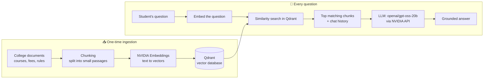
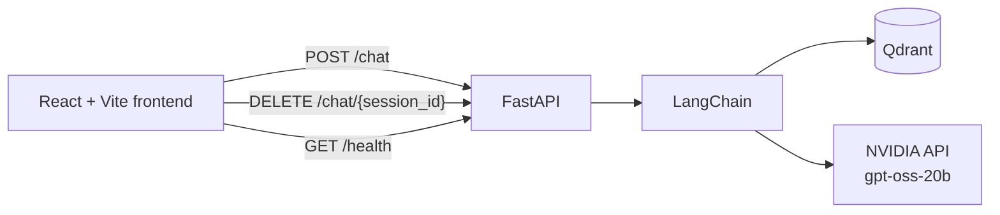

<div align="center">

# 🎓 NCET Smart Admission Assistant

### An AI-powered virtual admission counsellor for Naraina College of Engineering & Technology, Kanpur

Ask about courses, admissions, eligibility, fees and campus facilities, and get instant answers grounded in the college's own knowledge base.


</div>

---

## ✨ What is this?

Students and parents usually have the same questions: *Which courses are offered? How do I apply? What are the fees?*
The **NCET Smart Admission Assistant** answers them in a friendly chat, 24/7.

It does not guess. It uses **Retrieval-Augmented Generation (RAG)**: for every question it first **searches the college's
knowledge base**, then asks a large language model to write an answer **using only what it found**. That keeps replies
relevant to NCET instead of generic.

---

## 🧠 How it works (RAG pipeline)



| Step | What happens | Why it matters |
| ---- | ------------ | -------------- |
| **1. Chunking** | Source documents are split into small, overlapping passages. | Small chunks retrieve precisely and fit inside the model's context window. |
| **2. Embedding** | Each chunk is converted into a vector by **NVIDIA embeddings**. | Vectors capture meaning, so "fees" can match "tuition cost". |
| **3. Vector storage** | Vectors are stored in **Qdrant**. | Fast similarity search over the whole knowledge base. |
| **4. Retrieval** | The user's question is embedded the same way and the closest chunks are fetched. | Only relevant facts reach the model. |
| **5. Generation** | The **LLM** receives the question, the retrieved chunks and the conversation history, and writes the answer. | Natural, conversational replies based on real college data. |
| **6. Memory** | The backend keeps history per `session_id`. | Follow-ups like "what about its fees?" work. |

> **Tuning values:** fill in the exact settings of your deployment here so the README stays accurate.
>
> | Setting | Value |
> | ------- | ----- |
> | Chunk size / overlap | _fill in_ |
> | Embedding model | _fill in_ |
> | Top-k retrieved chunks | _fill in_ |
> | Qdrant collection name | _fill in_ |

---

## 🧰 Tech stack

### 🖥️ Frontend (this repository)

| Technology | Used for |
| ---------- | -------- |
| **React 18** | Component-based UI |
| **Vite 5** | Fast dev server and production build |
| **Tailwind CSS 3** | Styling and responsive layout |
| **Axios** | HTTP requests to the backend |
| **Lucide React** | Icons |
| **React Router 6** | Home and chat pages |
| **react-markdown + remark-gfm** | Clean rendering of AI replies (lists, tables, bold, links) |

### ⚙️ Backend (separate, already implemented)

| Technology | Used for |
| ---------- | -------- |
| **Python + FastAPI** | REST API (`/chat`, `/health`) |
| **LangChain** | Orchestrates retrieval and generation |
| **Qdrant** | Vector database for the knowledge base |
| **NVIDIA Embeddings** | Turn text into vectors |
| **NVIDIA API** | OpenAI-compatible chat completion endpoint |
| **openai/gpt-oss-20b** | The LLM that writes the final answer |

---

## 🚀 Features

- 🏠 **Home page:** sticky navbar, hero with the campus photo, quick-info cards, About section, footer
- 💬 **Full chatbot:** sidebar, welcome screen, one-click suggested questions
- 📝 **Markdown replies:** bullets, numbered lists, tables and links render cleanly
- ⌨️ **Smart input:** Enter to send, Shift+Enter for a new line, auto-resize, 2000-character limit with a counter
- ⏳ **Typing indicator** and duplicate-send protection while the AI thinks
- 📋 **Copy button** on every AI reply
- 🟢 **Honest status light:** green, red or yellow from a real `/health` check, never a fake "online"
- 🛟 **Friendly errors** with a "Try again" button (network, 400, 500, timeouts, empty replies)
- 🧵 **Conversation memory** that survives a page refresh
- 📱 **Responsive:** the sidebar becomes a slide-out drawer on mobile

---

## 🏗️ Architecture



### API contract

| Method | Endpoint | Purpose |
| ------ | -------- | ------- |
| `POST` | `/chat` | Send a message, receive the AI reply |
| `DELETE` | `/chat/{session_id}` | Clear a conversation on the server |
| `GET` | `/health` | Check that the backend is running |

```jsonc
// POST /chat
{ "message": "What courses are available at NCET?", "session_id": null }
// response
{ "session_id": "generated-session-uuid", "response": "..." }

// GET /health
{ "status": "healthy", "service": "NCET Admission Assistant" }
```

### 🧵 Session handling

1. The first message is sent with `session_id: null`.
2. The ID returned by the backend is saved in React state and `localStorage` (`ncet_session_id`).
3. Every later message reuses it, even after a refresh, so the AI keeps context.
4. **New Chat** calls `DELETE /chat/{session_id}`, clears the messages and removes the stored ID.

The backend keeps sessions in memory and has no "list all chats" endpoint. The chat text shown after a refresh is stored
in your browser (`ncet_messages`), so this history is local to the device and the UI says so.

---

## ⚡ Quick start

**Prerequisites:** Node.js 18+ and your FastAPI backend running.

```bash
# 1. Install
npm install

# 2. Configure the backend URL
cp .env.example .env          # Windows (cmd): copy .env.example .env

# 3. Run
npm run dev                   # http://localhost:5173
```

`.env`:

```env
VITE_API_BASE_URL=http://127.0.0.1:8000
```

The URL is read in one place only: `src/config/api.js`. Restart the dev server after editing `.env`.

| Command | Purpose |
| ------- | ------- |
| `npm run dev` | Start the dev server |
| `npm run build` | Production build into `dist/` |
| `npm run preview` | Preview the production build |

---

## ☁️ Deploying with your hosted backend

1. Set `VITE_API_BASE_URL=https://your-backend.example.com` (no trailing slash). On Vercel or Netlify add it as an
   environment variable and **redeploy**, because Vite bakes it in at build time.
2. Build with `npm run build` and deploy `dist/`. `vercel.json` and `public/_redirects` are included so `/chat` works on refresh.
3. Allow your frontend origin in the backend's **CORS** settings (for example `https://your-site.vercel.app` and
   `http://localhost:5173`).
4. If the site is on `https`, the backend must be on `https` too (browsers block mixed content).

---

## 📁 Project structure

```
src/
├── assets/            ncet-logo.jpeg, ncet-campus.jpeg
├── components/
│   ├── Navbar.jsx            Sticky, responsive navbar
│   ├── Hero.jsx              Hero with campus photo
│   ├── FeatureCards.jsx      Quick-info cards (open the chat with a starter question)
│   ├── Footer.jsx            Footer and contact block
│   ├── ChatSidebar.jsx       Branding, New Chat, current conversation (drawer on mobile)
│   ├── ChatWindow.jsx        Header, messages, welcome screen, notices
│   ├── ChatMessage.jsx       User/AI bubbles, Markdown, copy, retry
│   ├── ChatInput.jsx         Auto-resizing input with limits
│   ├── TypingIndicator.jsx   Animated dots
│   ├── ConnectionStatus.jsx  Live backend status
│   └── Avatar.jsx            Logo avatar for AI messages
├── config/
│   ├── api.js                Backend URL + Axios instance
│   └── site.js               Copy, suggested questions, footer contact
├── hooks/useChat.js          Session, messages, loading, health polling
├── services/chatService.js   All API calls + error mapping
└── pages/                    Home.jsx, ChatPage.jsx
```

## 🎨 Customisation

- **Footer contact details:** fill in `phone`, `email`, `address` in `src/config/site.js` (empty by default, shown once set).
- **Suggested questions and welcome text:** `src/config/site.js`.
- **Colors:** `tailwind.config.js`. Navy `#102A43`, royal blue `#2563EB`, gold `#F4B942`, background `#F5F7FA`,
  text `#1E293B`, and a leaf green `#2F8F3E` taken from the logo's shield.
- **Fonts:** Fraunces (headings) and Figtree (body), loaded in `index.html`.
- **Images:** replace the files in `src/assets/` and `public/ncet-logo.jpeg` (favicon).

---

## 🛠️ Troubleshooting

| Problem | Likely cause and fix |
| ------- | -------------------- |
| Status dot is red | Backend not running, wrong `VITE_API_BASE_URL`, or CORS. Check `/health` in the browser's Network tab. |
| "I'm having trouble connecting right now" | Same causes. Click the status dot to re-check. |
| CORS error in the console | Add the frontend origin to the backend's allowed origins. |
| Works locally, fails after deploy | The env variable wasn't set at build time, or it uses `http` on an `https` site. Set it and redeploy. |
| `/chat` gives 404 on refresh | Host needs a single-page-app fallback to `index.html` (included for Vercel and Netlify). |
| Follow-ups lose context | Check `ncet_session_id` in `localStorage`. A backend restart clears its in-memory sessions. |
| Reset everything | Click **New Chat**, or clear `ncet_session_id` and `ncet_messages` from `localStorage`. |

## 🚫 Out of scope

Voice chat, authentication, user registration and payments are not part of the current backend.

---

<div align="center">

Built to help every NCET aspirant find answers quickly. 💙💛

</div>
